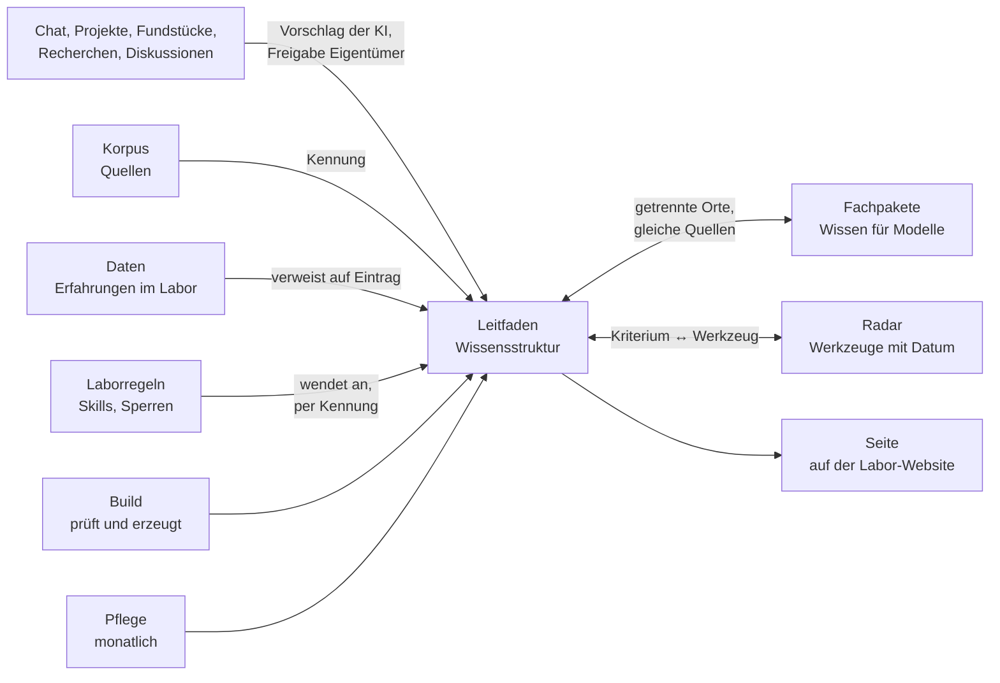

# Konzept Leitfaden · Iteration 1

## 1 · Worum es geht

Der Leitfaden ist eine **Wissensstruktur für Entwurfsarbeit**. Die KI ist darin ein Werkzeug unter
mehreren, neben Code, generativen und parametrischen Verfahren, Gestaltgesetzen und
Informationsarchitektur. Er ist der Ort, an dem der Gestalter Erkenntnis gewinnt: sich
orientieren, verstehen, dem Wachsen zusehen. Er ist auch für andere nutzbar.

Ein Eintrag trägt das Wissen allgemein formuliert und mit Quellen aus der Fachwelt. Er nennt keine
eigenen Arbeiten, Issues, Dateien oder Vorfälle des Labors: Solche Verweise altern mit dem Labor
und machen jede Aktualisierung zur Pflege der Beispiele.

Die Halbwertszeit bleibt, wie sie am 05.11. angelegt wurde: Einträge werden monatlich geprüft,
Überholtes bleibt sichtbar markiert.

## 2 · Der Leitfaden unter den Bausteinen des Labors

| Baustein | Was er ist, wo er liegt | Verhältnis zum Leitfaden |
|---|---|---|
| **Korpus** | Verweise auf Quellen mit Status (gesehen, abgeleitet, nicht belegt); `corpus/referenzen.json` (vom Eigentümer gewählt), `corpus/recherche.json` (von Agenten gefunden) | Der Leitfaden zitiert nur per Kennung. Es gibt keine zweite Quellenliste. |
| **Fachpakete** | Fachwissen, das die Modelle bei der Arbeit laden: Kanon, Qualitätskriterien, Rolle der KI; heute „Form“ (Typografie) und „Vermitteln“ (Informationsdesign) in `.agents/skills/` | Getrennter Erkenntnisort, keiner ist die Ansicht des anderen, keine festen Wege dazwischen. Sie teilen Quellen und Fachbegriffe. |
| **Radar** | Werkzeuge und Entwicklungen mit Ring (einsetzen, erproben, beobachten, halten) und Datum; `radar.md`; hält Wochen bis Monate | Der Leitfaden sagt, *woran* man ein gutes Werkzeug erkennt; das Radar sagt, *welches* heute wo steht. Beide verweisen aufeinander. |
| **Daten** | Fragen an den Eigentümer mit Antwort im Wortlaut und Beobachtungen aus der Laborarbeit; `daten/*.json` | Eine Erfahrung im Labor verweist auf den Eintrag, nie umgekehrt. |
| **Laborregeln** | Wie Modelle im Labor arbeiten: `AGENTS.md`, Skills, automatische Prüfungen | Wenden Einträge an, am besten als technische Sperre statt als Satz, und nennen die Kennung des Eintrags. |
| **Entscheidungen** | Begründete Strukturentscheidungen; `decisions/`; den Leitfaden regelt Entscheidung 0032 vom 05.11. | Legen Form und Mechanik des Leitfadens fest. |
| **Fundstücke** | Eingang für Neues von außen, bewertet vor Übernahme; Skill `fundstueck` | Eine Quelle geht in den Korpus, ein Werkzeug ins Radar, ein Muster als Kandidat in den Leitfaden. |
| **Build** | `tools/build.mjs`: prüft alle Daten und erzeugt die Seiten | Erzeugt die Seite; prüft Pflichtfelder, Quellen und Verweise. |
| **Pflege** | Geplante Routine; Skill `pflege`, monatlicher Teil „Leitfaden“ | Öffnet Quellen erneut, markiert Überholtes, legt neue Kandidaten vor. |

## 3 · Wie der Leitfaden wirkt

1. **Eingang.** Wissen entsteht zuerst im Chat, nebenbei: in Projekten, aus Fundstücken,
   Recherchen, Diskussionen und der Arbeit am Labor. Die KI bemerkt es und schlägt den Ort vor;
   der Eigentümer gibt frei, ob es bleiben soll. Es gibt keine festen Wege und keinen festen
   Auslöser.
2. **Reifen.** Ein Eintrag darf werdend sein: ein Satz, Tags, Datum. Er gilt erst, wenn
   Fachbegriff, Begründung, Grenzen und eine geprüfte Quelle da sind; der Build lässt „gilt“
   vorher nicht zu. Überholtes bleibt mit Datum und Verweis auf den Nachfolger stehen.
3. **Ordnen.** Freie Tags und Relationen zwischen Einträgen statt fester Bereiche. Die Ordnung
   zeigt sich aus dem Material und wird nicht vorab festgelegt.
4. **Sichtbar machen.** Aus denselben Daten erzeugte Ansichten: Filter nach Tags, Netz der
   Relationen, Verlauf des Wachsens. Die KI meldet ähnliche Tags, isolierte Einträge und Keime ohne
   Quelle.
5. **Aktuell halten.** Die monatliche Pflege öffnet die Quellen, prüft gegen Neues und markiert
   Überholtes. Weil Einträge keine Laborverweise tragen, berührt eine Änderung nur den Eintrag
   selbst.
6. **Zusammenhalten.** Ein einziger Konzeptstand. Bei jeder neuen Erkenntnis prüft die KI, was
   sie am Ganzen verschiebt, und schreibt den Stand als Ganzes neu. Der Eigentümer sieht, was sich
   bewegt hat, nicht eine Folge von Nachträgen.

## 4 · Synergien und Abhängigkeiten

| Wenn sich das ändert … | … dann am Leitfaden | Wer merkt es |
|---|---|---|
| Eine Quelle im Korpus verschwindet oder ändert ihren Status | Der Eintrag verliert seinen Beleg | Build |
| Dieselbe Erkenntnis steht in einem Fachpaket oder einer Laborregel mit eigenem Wortlaut | Dopplung, die auseinanderläuft (heute: „Sperre statt Satz“ an drei Orten) | heute niemand; Prüfung auf Dopplungen fehlt |
| Eine neue Modellgeneration erscheint | Einträge über Verhalten der Modelle können kippen | Pflege |
| Das Labor ändert seine Struktur | nichts, weil Einträge keine Laborverweise tragen | – |
| Ein Fundstück oder eine Recherche bringt ein Muster | Kandidat, werdend | KI, Freigabe Eigentümer |
| Das Radar stuft ein Werkzeug um | Einträge, die das Kriterium liefern, bleiben gleich | – |

**Synergien:** Korpus und Pflege prüfen eine Quelle einmal für Leitfaden und Fachpakete.
Laborregeln werden kürzer, wenn sie per Kennung auf einen Eintrag zeigen, statt das Wissen neu zu
formulieren. Fachbegriffe und Tags machen den Leitfaden anschlussfähig an die Fachwelt und durch
andere nutzbar.

## 5 · Der Bestand heute

**Seite „Mit KI arbeiten“** (`leitfaden/eintraege.json`, auf der Labor-Website unter
`leitfaden/`), 24 Einträge in drei Bereichen:

- **Grundlagen**, 11 Einträge, z. B. „Sag, wofür – nicht nur was“ und „Gib der KI eine Prüfung,
  die sie selbst ausführen kann“.
- **Werkzeuge entwerfen**, 7, z. B. „Was immer gelten muss, als Sperre bauen, nicht als Satz“.
- **Überholt**, 6, z. B. „Du bist ein erfahrener Experte für …“ und „Denk Schritt für Schritt“.

Alle 24 handeln von der Arbeit mit KI: Sie füllen eine Region der Entwurfsarbeit, die übrigen
sind leer. 14 tragen Belege aus dem Labor (Feld `labor`); vier stützen sich nur darauf und haben
keine Quelle aus der Fachwelt: „Verlange zu jeder Aussage, woher sie kommt“, „Antworte auf einen
Fehler nicht reflexhaft mit einer neuen Regel“, „Halte den Stand an genau einem Ort“, „Grün ist
nicht fertig“.

**Keime** im Entwurf vom 07.11. (`research/2026-11-wissensformen/leitfaden-wachsend.md`,
Abschnitt 3): 22 Muster, z. B. „Lass ein System aus einem einfachen, funktionierenden wachsen“
(Gall's Law) oder „Trenne Fragen nach Ebene, bevor du Positionen abwägst“ (IBIS). Einige stützen
sich nur auf Aussagen aus dem Labor.

## 6 · Was sich gegenüber früheren Ständen verschiebt

- **Entscheidung 0032 (05.11.):** Gegenstand und Name „Mit KI arbeiten“ sind überholt. Die drei
  festen Bereiche weichen Tags. Mechanik, Stufen, Pflege und Umgang mit Überholtem bleiben.
- **Konzeptstand 08.11.:** geht hier auf. Neu: Abhängigkeiten zu den anderen Bausteinen, keine
  Laborverweise in Einträgen, ein Stand statt Nachträgen.
- **Formatentwurf vom 08.11.** (`leitfaden-eintrag.md`, PR #164): kam vor dem Konzept. Er ist
  Material für den Bau und wird erst danach gegen dieses Konzept geprüft.

## 7 · Offen

1. Der **Name** des Leitfadens.
2. **Ein Leitfaden oder mehrere** (etwa einer je Region der Entwurfsarbeit).
3. Was mit **implizitem Wissen** gemeint ist: nur, dass der Eintrag das Wissen allgemein trägt,
   oder dass der Leitfaden das stillschweigende Können der Entwurfsarbeit erschließen soll.

## Nicht geprüft

- Die vier Einträge ohne Quelle aus der Fachwelt: Ob es eine gibt, ist nicht gesucht.
- Wie viele Einträge Laborbezüge im Text haben, nicht nur im Feld `labor`.
- Abschnitt 4 ist aus dem Aufbau des Repos abgeleitet, nicht an einem Fall erprobt.

Für die Modelle: Fundstellen

- Antworten des Eigentümers im Wortlaut: `daten/arbeitsweise.json`, f16, f18–f25, f28–f31, f36;
  Chat 09.11. (Qualität, Synthese, generisch, Entwurfsgegenstand, Stränge halten, keine Verwaltung,
  Halbwertszeit bleibt) noch nicht in `daten/`.
- Bausteine: `research/2026-11-wissensformen/konzept.md` Abschnitt 2 (Grenze Leitfaden–Radar gilt
  weiter); `fachpaket-ki-werkzeug.md` (Befund Dopplung); `decisions/0021`, `0031`, `0032`;
  Skill `pflege`, Abschnitt „Monatlich: Leitfaden“.
- Stand der Technik zum Vorgehen (Chat 09.11., gesichtet): Horvitz 1999 (Mixed Initiative);
  Pu u. a., CHI 2025 (proaktive KI); Design Council, Double Diamond; Wen u. a. 2025 (Fixierung);
  Böckeler 2025 (Spec-Driven Development).

